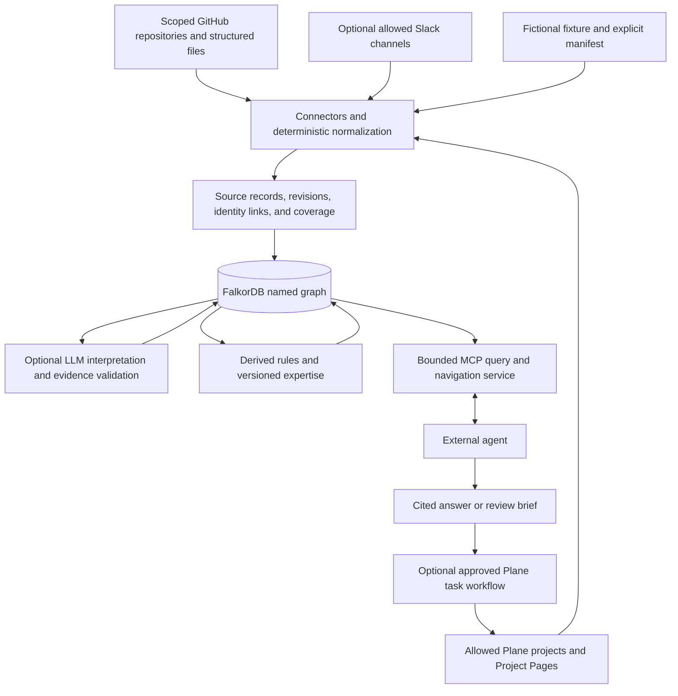

# 1. Product and system architecture

[Design pack](README.md) · [Next: graph and evidence model](02-graph-and-evidence-model.md)

## Problem and intended outcome

Engineering knowledge is distributed across project trackers, documentation, conversations, repository activity, and ownership declarations. A useful answer often requires joining them: identify a component, find responsible people, inspect related work, recover a decision, and check whether a concern actually received a resolution.

Wayfinder stores those connections as an inspectable property graph. Its principal outcome is an evidence-backed engineering investigation. A reviewer should be able to follow an answer back through a relationship, an imported record, and the source text used to interpret that record.

The application supports these questions:

| Question | Required distinction |
|---|---|
| Who owns this component? | Declared component responsibility versus work-item assignment |
| Who has relevant engineering activity? | Strong implementation or file-review evidence versus general involvement |
| Why was this approach chosen? | Recorded decision versus proposal, goal, or status observation |
| What objections remain? | Open concern versus proposed response versus qualifying recorded resolution |
| What should we do next? | Evidence-backed proposal versus approved external action |
| Can we trust this answer? | Current source evidence, import coverage, interpretation limits, and uncertainty |

## Release scope

There are two complementary application contexts.

**Kubernetes pilot.** Scoped repository imports connect people, SIGs, subprojects, directories, OWNERS declarations, KEPs, feature gates, releases, documentation, pull requests, reviews, and discussions. This context supplies code ownership and versioned directory expertise.

**Company sandbox.** An explicitly synthetic manifest defines a fictional organization, teams, identities, components, owners, and allowed projects/channels. Plane supplies work items, comments, and Project Pages; optional Slack supplies conversations. Eight synthetic GitHub PRs and OWNERS declarations connect the same company identities to real v2 code-expertise calculations through IMPLEMENTED_IN. A bundled fixture supports the same demonstration without live accounts or model requests.

The company connector and action paths target fictional sandboxes in this release. There is no general production company directory integration, HR import, confidential workspace authorization model, or automatic discovery of every project and channel.

## Architecture

The diagram shows logical responsibilities. Several responsibilities execute in the same local Python application; they are not independently deployed services or a message-driven platform.

## Responsibilities and boundaries

| Part | Responsibility | Boundary |
|---|---|---|
| Manifest | Declare company scope, identity mappings, component owners, explicit bindings, and allowed destinations | Configuration is trusted input; it can declare relationships that were not discovered from a source |
| Connectors | Retrieve accessible scoped records, paginate, retain provenance, and record gaps | Successful HTTP responses do not prove complete history or organization-wide coverage |
| Deterministic parsers | Interpret structured metadata, ownership files, commands, sections, and exact references | A parsed field confirms what the source says, not whether it is organizationally correct |
| Source store | Maintain current records, text revisions, relationship validity, and coverage observations | It is not a complete event log or a full historical copy of every source field |
| Semantic extraction | Propose typed meaning, verify quotes and targets, and publish a validated interpretation | Quote presence does not prove that a summary is entailed by the text |
| Derived processing | Calculate expertise, concern status, collaboration signals, and stale findings | Derived results remain rules or heuristics, not independent truth |
| MCP service | Provide bounded read-only queries, traversal, and evidence retrieval | It does not itself run an autonomous planning loop |
| External agent | Decide which tools to call and compose an answer or brief | Tool instructions guide behavior but do not guarantee every natural-language answer is accurate |
| Optional action service | Prepare and execute one approved task in an allowed Plane sandbox | No general workflow engine, arbitrary tool execution, or unrestricted project modification |

## Why a graph

The central value is inspectable connection. A component can be linked to declared owners, a project, work items, discussions, pages, and semantic claims. An agent can follow the links without needing a separate fixed endpoint for every possible investigation.

FalkorDB holds typed nodes, directed relationships, properties, temporal intervals, and indexes. It also supplies the graph algorithms used for exploratory derived signals. Relationship direction and meaning matter: an author link does not mean ownership, and a shared target does not mean one claim supports another.

This flexibility has costs. Broad traversals can be expensive, high-degree nodes can distract retrieval, and poorly chosen relationship meanings can amplify misleading conclusions. Explicit relationship semantics, bounded tools, and source inspection are therefore part of the design.

## Three knowledge layers

| Layer | Contents | Answer wording |
|---|---|---|
| Structure | People, teams, components, documents, work items, source authorship, assignments, declared ownership, exact links | “The imported manifest declares…” or “The source assigns…” |
| Meaning | Arguments, concerns, decisions, rationales, questions, answers, and topic associations | “The text records…” with the quote and revision; distinguish model output from fixture annotations |
| Derived | Expertise, unlisted experts, concern status, collaboration, communities, importance, and stale findings | “The configured rule computes…” with parameters, evidence, and limitations |

An answer can use all three layers, but should preserve their different authority. Repetition across them is not independent corroboration when all paths ultimately depend on the same source.

## Documentation choice

The selected company documentation source is Plane Project Pages for ownership pages, ADRs, RFCs, and runbooks. This keeps documentation near project work and avoids requiring Confluence. If the configured account cannot expose Pages through its API, the application supports a scoped export import with explicit partial-snapshot limitations.

Attachments supplement pages. Only small supported text attachments receive content ingestion; a PDF attachment being listed does not mean its contents were understood. Slack is optional discussion evidence, not the primary authoritative ownership directory.

This is the implemented integration choice. It is not a current guarantee about vendor plan pricing or account entitlements; capability checks must establish access for the actual workspace.

## Deployment and data boundaries

The reviewed deployment is a local Python application, a Docker-hosted FalkorDB instance, local caches/artifacts, and an MCP process launched by an agent client. Optional network dependencies are GitHub, Plane, Slack, and configured OpenAI-compatible generation/embedding providers.

Named graphs separate the Kubernetes pilot, company demo, and isolated tests. This prevents accidental fixture mixing when the correct graph is selected. A named graph is not a tenant authorization mechanism: a process with database access can potentially access other graphs.

Ingestion, extraction, refresh, and querying are separate activities. Starting the MCP server does not import sources, spend provider requests, or refresh derived snapshots automatically. An explicit semantic_search call makes one query-embedding request; other read tools make no provider calls. Scheduled polling and expertise refresh require explicit setup. Polling every ten minutes is a scheduling option, not a freshness guarantee.

## Deliberate design choices

| Choice | Benefit | Tradeoff |
|---|---|---|
| Explicit identity mappings | Avoids merging people by matching names | Requires maintained configuration; unmatched identities stay separate |
| Evidence-backed claims | Makes interpretation inspectable | More storage and validation work; semantic mistakes remain possible |
| Scope and coverage in responses | Prevents missing data being presented as inactivity | Responses are more verbose and agents must use the context correctly |
| Per-unit semantic publication | Prevents visible partial writes within a published interpretation | Does not make an entire multi-source sync atomic |
| Versioned expertise snapshots | Reproducible rankings and safe publication | Retained generations increase storage |
| Read-only MCP by default | Separates investigation from external mutation | Requires an explicit additional workflow to perform an action |
| Hash-bound human approval | Binds approval to a concrete proposal | The local approval boundary is not an enterprise identity or authorization service |

## Product success boundary

A credible demonstration is a complete investigation from component to owners, work, documents, discussions, a recorded decision, concern status, and a cited follow-up brief. The design does not yet establish universal company understanding, reliable staff selection, or unattended business operation. [Review and evaluation](05-review-and-evaluation.md) defines how to assess those claims.
