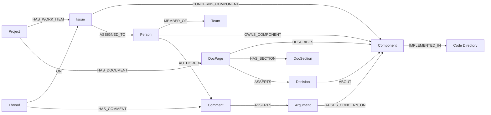

# 2. Graph ontology and evidence model

[Design pack](README.md) · [Previous: architecture](01-system-design.md) · [Next: data lifecycle](03-data-lifecycle-and-quality.md)

## Model conventions

Wayfinder uses a labeled property graph. A node represents an entity, source record, interpretation, or operational record. A directed relationship describes a specific connection. Properties hold identifiers, source references, timestamps, text, status, and calculation metadata.

The catalog below describes the logical model used by the application. FalkorDB is not being used as a relational database with exhaustive foreign-key and required-field constraints. Some operational records have fewer provenance fields than ordinary source records. Model definitions and the actual stored graph can therefore differ; schema discovery and record inspection are part of review.

## Structural entity catalog

| Entity | Meaning | Important information | Applies to |
|---|---|---|---|
| Organization | Fictional company boundary | Name, organization identifier, synthetic marker | Company |
| Person | Canonical or source-specific identity | Stable ID, login, optional display name, bot flag | Both |
| Team | Explicit company team | Name, organization | Company |
| Component | Named responsibility or system area | Name, organization | Company |
| Project | Plane project | Native ID, name, source scope | Company |
| Issue | Work item or GitHub issue | Native identity, title, state, source text, timestamps | Both |
| PullRequest | Repository change proposal | Repository, number, author links, state, merge time | Both |
| Review | Submitted PR review | State, submission time, review body | Both |
| Comment | Issue, chat, review, or file-anchored comment | Kind, author link, text, time; file path when available | Both |
| Thread | Conversation grouping | Root record, kind, source identifiers | Both |
| DocPage | Documentation page | Title, path/native ID, current text and revision | Both |
| DocSection | Section selected for interpretation | Heading, order, text and revision | Both |
| Attachment | Work-item attachment | Name, type, URL, eligible text when available | Company |
| SourceLink | Imported link awaiting or supporting resolution | Origin record and destination URL | Company |
| SIG and Subproject | Declared Kubernetes organization | Names and declared governance/membership | Kubernetes |
| Repository, Directory, File | Code/document hierarchy | Repository and path | Both |
| OwnersFile | Declared code governance | Path, inherited ownership behavior, reviewer/approver links | Both |
| KEP and KEPSection | Enhancement metadata and source sections | Number, title, status, stage, section text | Kubernetes |
| FeatureGate and Release | Feature maturity observations | Gate identity, release, stage/default properties | Kubernetes |

People, projects, and components are not interchangeable. Being assigned an Issue does not establish component ownership. Authoring a PR does not establish reviewer authorization. Team membership is an explicit relationship rather than an inference from co-occurrence in chat.

### Graph and identity scope

Entity IDs must be interpreted together with the selected named graph. Kubernetes source entities commonly use the `k8s:` namespace. Northstar canonical people and Components use `company:northstar:`, its synthetic GitHub activity uses `github:northstar:`, and its Plane-shaped records use `plane:northstar:`. Explicit identity mappings join those company records to the same fictional people; they do not map them to Kubernetes contributors.

Namespaces are not a source-trust or access-control boundary. Some retained semantic Topic IDs can have a legacy prefix; inspect their provenance, source revision, and containing graph instead of inferring dataset origin from a prefix alone. `IMPLEMENTED_IN` connects a Northstar Component to its code Directory within the company graph, not to a Directory in the Kubernetes graph.

## Semantic and derived entities

| Entity or record | Meaning | Review requirement |
|---|---|---|
| Topic | A named semantic subject with optional embedding | Similarity is a retrieval aid, not identity or causality proof |
| Argument | Proposal, support, objection, concern, explanation, or resolution claim | Read its quote, source, actor, and target |
| Decision | Text interpreted as an outcome or a structured metadata observation | Distinguish a decision from a goal; do not invent decision maker or transition time |
| Rationale | Motivation, goal, non-goal, alternative considered, or alternative rejected | Rejection requires explicit evidence; an Alternatives heading is insufficient |
| Question | Extracted question | Absence of a linked answer may reflect missing import data |
| Community | Computed group in a collaboration projection | Not a verified organizational team |
| StaleFinding | Rule-generated discrepancy or follow-up candidate | Verify underlying sources before treating it as a defect |
| ExpertiseContribution | Immutable contribution allocation in a scoring generation | Inspect event, directory, channel, weight, decay, and PR |
| ExpertiseSnapshot and ExpertiseState | Complete calculation generation and published pointer | Use the published generation, not staging records |
| Action | Proposed or approved external task operation | Inspect exact payload, approval hash, state, and cited evidence |

Answers are represented by links from source comments to Question nodes. Concerns are Argument nodes with a concern kind and computed status, rather than a separate Concern label.

## Core company graph

This is a representative set of supported paths, not a promise that every possible edge appears in every dataset. Some connections come from explicit manifest bindings. Revision pointers are properties on records; a conceptual reference to a revision should not be mistaken for an additional graph relationship.

## Relationship semantics

| Family | Relationship and direction | Meaning and limit |
|---|---|---|
| Responsibility | Person → OWNS_COMPONENT → Component | Explicit manifest declaration; not code review authority |
| Implementation | Component → IMPLEMENTED_IN → Directory | Explicit code scope for deduplicated v2 contribution aggregation |
| Code ownership | Person → APPROVER_IN / REVIEWER_IN → OwnersFile → COVERS → Directory | Declared code role, with inheritance and validity |
| Assignment | Issue → ASSIGNED_TO → Person | Work-item assignment; distinct from ownership |
| Structure | Project → HAS_WORK_ITEM / HAS_DOCUMENT → Issue / DocPage | Source containment |
| Scope | Project or Issue → CONCERNS_COMPONENT → Component; DocPage → DESCRIBES → Component | Explicit configured/source link, not inferred from a similar title |
| Authorship | Person → AUTHORED → source record; Person → SUBMITTED → Review → REVIEWS → PullRequest | Who produced the record, not whether it is correct |
| Conversation | Thread → HAS_COMMENT → Comment; Thread → ON → Issue / PullRequest; Comment → REPLIES_TO → Comment | Imported conversation organization; inspect source kind |
| Source meaning | Source unit → ASSERTS → claim; Person → MADE → claim | Interpretation tied to a text unit and its known author |
| Decision context | Decision → ABOUT → target; KEP → HAS_RATIONALE → Rationale | Explicit semantic association; shared targets do not establish rationale support |
| Debate | Argument → SUPPORTS / OPPOSES → target; Argument → RAISES_CONCERN_ON → target | Proposed semantic relationship requiring its evidence |
| Response | Argument → ADDRESSES → concern; resolution Argument → RESOLVES → concern | A proposed response differs from a qualifying closure |
| Reference | Source record → REFERENCES → target | Exact resolved reference; not proof of dependence, agreement, or causality |
| Dependency | Source record → DEPENDS_ON → target | Available for explicit bindings; free-text dependency lists are not automatically authoritative relations |
| Code change | PullRequest → TOUCHES → File; Directory → CONTAINS → File; child Directory → CHILD_OF → parent Directory | Physical change scope; a PR-wide comment is not file-specific expertise |
| Expertise | Person → EXPERT_IN / UNLISTED_EXPERT → Directory or Topic | Computed activity signal, version-dependent |
| Collaboration | Person → WORKS_WITH → Person; Person → IN_COMMUNITY → Community | Co-activity projection, not formal reporting structure |
| Findings | StaleFinding → CONCERNS → subject; StaleFinding → EVIDENCE → source | Computed candidate and supporting inputs |
| Action trace | Action → BASED_ON → evidence node | Evidence-node links supplement the full cited ID list; relationship evidence can remain in the payload |

## Identity and stable identifiers

Stable identifiers are namespaced by source and context. For example, `company:northstar:component:resource-allocation` identifies the fictional component, while `plane:northstar:issue:w7` identifies a fictional Plane item. Kubernetes identifiers retain repository context where needed.

Cross-source company identity is resolved only through explicit mappings from source-native IDs to a canonical Person. Matching display names are not evidence that two accounts belong to the same person. Unmapped identities remain separate, which can undercount one person's work but avoids silently joining unrelated people.

Relationship history distinguishes a logical relationship from a particular validity interval. Consumers should use stable or logical IDs provided by tools rather than internal database node numbers. Internal IDs are storage details and are unsuitable for long-lived citations.

## Provenance and authority

Ordinary source entities carry source system, source URL, source reference, source update time when known, observation time, validity information, and content identity where relevant. Semantic claims additionally carry an evidence quote, source revision, and extraction or annotation metadata. Derived outputs carry rule/scoring versions and evidence references where implemented.

| Authority | Meaning | What it does not prove |
|---|---|---|
| CONFIRMED | A relationship was obtained deterministically from configured structure, an API field, or an exact reference | That the source declaration is correct, current, independently corroborated, or universally authoritative |
| EXTRACTED | Interpretation attached to source text | Semantic correctness, valid reviewer authorization, or independent corroboration |
| COMPUTED | Result of application rules or calculations | Real-world truth, calibrated confidence, or organizational intent |
| CANDIDATE | Tentative vocabulary available in the model | A fully implemented human adjudication workflow |

Link method answers a separate question: how the relationship was produced. Methods distinguish structured files, APIs, exact references, LLM extraction, computation, and fixture annotation. An EXTRACTED fixture relationship is still hand-authored demonstration data when its method says FIXTURE_ANNOTATION.

Authority is not uniformly stored on every node. Relationships, source metadata, and semantic labels must be inspected together. A missing field must not be interpreted as CONFIRMED.

## Revision and time model

| Record or field | Purpose |
|---|---|
| SourceRevision | Retains the exact extracted-text version addressed by a revision ID |
| RawSourceRevision | Retains original imported HTML when a normalized text representation is also used |
| Current source revision pointer | Identifies the text version currently attached to the source unit |
| Source update/event time | When the source reports that a change or event occurred |
| Observation time | When Wayfinder observed it |
| Validity interval | When a stored relationship or record is treated as current by application queries |
| ConcernStatusRevision | Records concern status changes and the rule version |
| SourceCoverage / ActivityCoverage / ReviewThreadCoverage | Records import scope and completeness observations |
| SyncSource | Structured-source synchronization metadata |

Text revisions are content-addressed. Repeated identical text can reuse a revision; revisions are not a complete record of every edit event. Common normalized content hashes and exact revision identities serve different purposes and should not be treated as interchangeable.

Retained relationship intervals and text revisions support bounded historical inspection. Mutable node properties are not fully versioned, so arbitrary “what did the whole company know at time T?” reconstruction is not guaranteed. The system also does not implement source-level retention or erasure policies for confidential information.

## Indexing and consistency

Stable ID indexes support lookup for registered entity labels. The initialization path also defines full-text indexes for selected source labels and vector indexes for Topic, Argument, and Comment embeddings. Vector dimension is a deployment contract: provider output, stored vectors, and index configuration must agree. Equal vector length does not make two embedding models compatible.

Index creation can log warnings and continue. A successful initialization message alone is therefore insufficient evidence that every index exists. MCP entity search remains exact-first lexical retrieval. The explicit semantic_search tool calls native vector indexes using one configured query embedding. Company capability setup also strictly verifies Topic/Argument/Comment full-text and vector indexes.

Cross-record consistency is enforced through application rules, bounded publication mechanisms, and tests rather than an exhaustive database schema. [Data lifecycle](03-data-lifecycle-and-quality.md) describes those guarantees and their limits.
