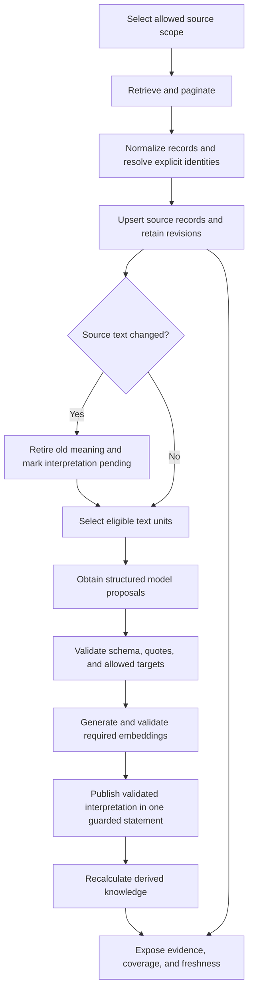
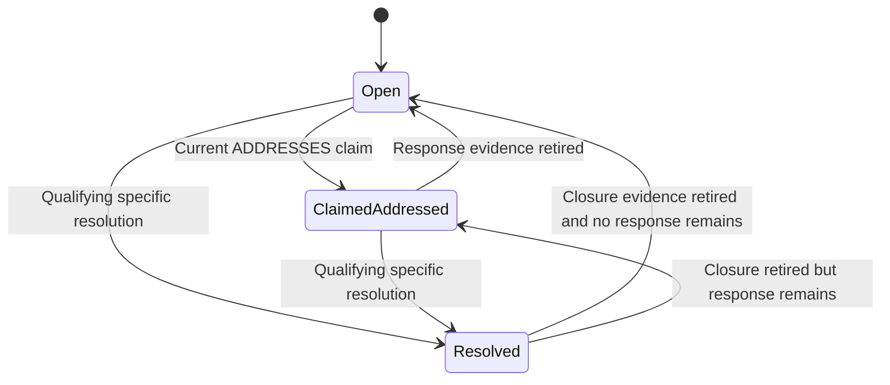

# 3. Population, freshness, and derived knowledge

[Design pack](README.md) · [Previous: graph model](02-graph-and-evidence-model.md) · [Next: agent and action design](04-agent-and-action-design.md)

## Lifecycle overview

The lifecycle runs within the explicitly selected graph. Importing the Northstar fixture or syncing the live graph never touches another named graph. Recalculating expertise is a separate operation and may legitimately change scores as time or imported evidence changes.

Company fixture ingestion is distinct from the local live-proof overlay. The fixture establishes authored baseline source text and annotations; the proof then changes the allocation ADR locally, retires its old interpretation, and publishes a real model-extracted replacement. Reimporting the complete fixture can restore its seeded ADR and retire that replacement. A saved successful proof remains a historical artifact and must be marked archived when its revision no longer matches the current source. Opening a dashboard or MCP session does not perform either import.

Information moves through separate stages: retrieve scoped sources, normalize and link them, retain text revisions, optionally interpret eligible text, calculate derived signals, and expose the result with coverage context. Each stage can succeed or fail independently. A source import can be useful before any model extraction succeeds.

The fixture supplies hand-authored interpretations instead of using the model path. Interpretation publication is atomic at one source-unit boundary; source ingestion and a complete multi-source refresh are not globally atomic.

## Source-specific population

| Source | Imported information | Completeness and linking behavior |
|---|---|---|
| GitHub activity | Issues/PRs of the configured repository, changed files, reviews, conversation comments, file-review threads, references, commands; branches with heads and recent history; commits; PR head/base refs and merge commits | PR search is fully paginated; commit history is bounded per branch and recorded as partial coverage; deleted branches are retired; file anchoring is kept when available |
| Plane | Allowed projects, members, states, work items, assignments, comments, Project Pages, links, attachments | Small-sandbox full scans; failed scopes remain gaps; successful complete listings allow scoped reconciliation |
| Plane Pages export | Explicitly exported pages with original identifiers and export metadata | Partial observation; does not establish live freshness or deletion |
| Slack | Allowed public sandbox channel history, separately fetched replies, authors, message edits, permalinks | Bounded history with overlap; revisits saved threads; retention and missing permissions remain gaps |
| Company manifest | Organization, people, teams, identity mappings, components, owners, explicit bindings | Trusted configuration; not automatically discovered organizational truth |
| Bundled fixture | Synthetic source records and fifty hand-authored interpretations | Deterministic demonstration without external accounts or paid inference |

### GitHub search and pilot bounds

Activity search separates pull requests from issues. Uncapped retrieval uses fixed upper bounds and partitions time intervals when a search reaches the provider's result ceiling. If an interval cannot be safely partitioned further, retrieval fails instead of claiming completeness. Overlap and native-ID deduplication reduce boundary loss and replay duplication.

A pilot item cap limits top-level issues/PRs, not all resulting records or API calls. A single PR can produce many files, directories, reviews, and comments. Upsert counts are write counts, not counts of distinct newly added entities. Repeating a pilot can revisit earlier records; increasing the cap does not necessarily mean adding that many new PRs.

The requested activity window also does not restrict every related artifact to that age. Reference documents, retained prior imports, and fetched thread context can be older. A graph named `30d` is not an automatic retention policy.

### Plane and documentation handling

Page and comment HTML is retained as raw content and converted to text for interpretation. Visible text, headings, and HTTP links are preserved in the normalized representation. DocPages are split into DocSections. This is a practical text representation, not a faithful rendered document or a rich editor model.

Attachment metadata is linked to the work item. Content ingestion is limited to supported UTF-8 plain text or Markdown up to 1 MiB. Redirect destinations must be allowlisted, and Plane API credentials are not forwarded to external storage hosts. PDF, DOCX, OCR, and arbitrary attachment interpretation are outside this release.

Native task assignments remain assignment relationships. A component owner's name mentioned in a page does not automatically create a new declared owner without an explicit supported declaration/binding. Free-text dependencies are not silently promoted to graph dependencies.

### Slack bounds

History and replies have separate pagination and access requirements. Polling uses a thirty-day scope with five minutes of overlap and revisits known thread roots. Channel-level coverage remains partial, even when returned pages have been exhausted. Deleted parent threads, retention limits, inaccessible replies, and unavailable API capabilities can hide records.

Missing channel records therefore cannot establish that a person was inactive, a concern was never answered, or a discussion did not occur elsewhere. The connector reads discussions; it does not post Slack messages or download Slack files.

## Interpretation and evidence validation

| Stage | Rule | Failure behavior |
|---|---|---|
| Eligibility | Select supported source text; exclude unsuitable bots/command-only units in the relevant ingestion path; short text is skipped | Skipped is distinct from a successfully interpreted empty result |
| Context | Supply known target IDs, title, and bounded related/thread context | The model is not authorized to invent graph IDs |
| Proposal | Request typed structured output with closed item categories | Model/API failure is reported; it is not successful extraction |
| Schema checks | Validate item shape, fields, and enumerations | Reject invalid items and record diagnostics |
| Quote checks | Require the quote to occur in this source unit under defined normalization | Context text cannot substitute for a quote in the analyzed unit |
| Target checks | Require referenced IDs to be allowed; answer targets must be existing Questions; apply relation-specific checks | Invalid references are rejected |
| Embeddings | Require configured provider output with the correct dimension and finite numeric values | Failure prevents new publication; no fake semantic-vector fallback |
| Publication | Write the validated replacement set with source and generation guards | A concurrent source/generation change produces a conflict for retry |

An empty interpretation can be correct for commands, acknowledgments, links, or nontechnical content. Rejection rate is a diagnostic over proposed items, not a measure of how many text units contained useful knowledge. “Units examined” can include skipped units; an extraction-attempt cap is a different count. One attempt can require generation, several embeddings, and retries.

The validated subset of proposed items is published together. Item-level rejection does not require rejecting every otherwise valid item from that unit. Atomic publication prevents partial database writes for that set; it does not guarantee that the model found every meaningful statement or that all proposed items passed validation.

## Invalidation and publication

The extraction fingerprint includes exact input text, extractor version, generation model and endpoint, embedding model/dimension, prompt, schema, allowed targets, and supplied context. A change in these inputs makes earlier materialization ineligible for an unchanged-input skip.

When stored source text changes, its previous extracted claims are retired and interpretation becomes pending even if no model credentials are available. This prevents old meaning from remaining current merely because re-extraction could not run. Source text remains available for direct inspection.

If only extraction configuration changes and the source text is unchanged, the previous published interpretation remains until a replacement successfully publishes. Failed generation or embedding preparation does not retire the previous generation on its own. New publication checks the expected materialization marker, source text, and current target dependencies before replacing claims and their relevant links in one database statement.

This distinction matters: an edited source must invalidate stale meaning immediately, while a failed model upgrade must not publish half a new interpretation. Neither mechanism makes all imported sources or all derived outputs represent one shared instant.

## Deletion and reconciliation

Company source deletion is inferred only after an exhaustive authorized listing for the relevant scope. Missing records are marked deleted/retired, their current links are closed, and their extracted claims are retired. A partial export, failed request, missing capability, or bounded Slack history must not be treated as proof of deletion.

Coverage is source- and scope-specific. A successful work-item listing does not imply that its comments, pages, links, and attachments were also accessible. Reconciliation mechanisms vary across connectors; comprehensive GitHub deletion and lost-label reconciliation are not guaranteed.

## Coverage and freshness

| Indicator | Meaning | Common misinterpretation to avoid |
|---|---|---|
| Complete scope | A particular authorized listing or activity query completed under its recorded rules | “Everything in the company is known” |
| Partial scope | Some records were observed within a bounded or incomplete scope | “Missing records do not exist” |
| Unavailable scope | A source/capability could not be accessed | “There were zero records” |
| Successful observation time | Last successful observation relevant to source freshness | A failed polling attempt made the source fresh |
| Coverage watermark | Successful progress through a specified source scope | Proof of current semantic extraction or complete activity everywhere |
| Pending interpretation count | Current company comments/sections without a live extraction marker | Number of incorrect claims; fixture annotations can exist separately |
| Imported PR count | Graph-level retained PR population | Number of PRs supporting this particular answer |
| Supporting PR count | Per-ranking distinct PR support where calculated | Calibrated statistical confidence |

Company response context marks observations older than twenty minutes, or without a usable successful-observation time, as stale. Directory expertise snapshots older than two hours are marked stale. These are warning thresholds, not guaranteed refresh intervals. Coverage context is bounded and may summarize only a subset of stored coverage records.

Positive saved evidence may show activity despite incomplete coverage. Negative inactivity findings require stronger coverage conditions. The system must preserve Unknown when it cannot justify a negative conclusion.

## Directory expertise v2

The revised score measures saved merged implementation and file-specific peer-review evidence. It does not rank people by chat volume or count every command as technical expertise.

| Evidence channel | Base credit | Allocation |
|---|---|---|
| Merged PR authorship | 2 per PR | Split across distinct directly changed directories |
| Qualifying file-specific peer review | 2 per reviewer/PR/directory group | Multiple comments in the group do not multiply credit; latest qualifying comment dates the group |
| PR-wide approvals, review summaries, discussion | 0 expertise credit | Retained as separate involvement, with source scope/quotes |
| Bots, command-only/admin comments, self-review, unknown-author review | 0 | Excluded from strong expertise |

Each allocation decays continuously: contribution = allocated weight × 0.5 raised to the power of event age divided by configured half-life. For illustration, weight 2 becomes 1 after one half-life and 0.5 after two. Configured half-life is recorded with the snapshot; it is not fixed to the demo's original setting.

There is no hard age cutoff for saved directory v2 contributions. The configured recent window controls recent-activity counts, while import scope controls which evidence was ever saved. Older retained events can contribute after decay. Topic rankings retain legacy behavior and must not be presented as directory v2 rankings.

Parent-directory retrieval sums allocated contributions across matched descendants. It does not take the maximum subdirectory score or duplicate stored ancestor copies. A broad PR's authorship allocation is split, reducing the former full-credit multiplication across every touched area. A file-review contribution remains local to its anchored directory.

Snapshots retain contribution records and stage derived relationships before one guarded publication changes the active generation. A concurrent refresh that loses publication cannot replace the already published result. Historical snapshot selection supports bounded ranking history, while retained generations increase storage.

Results report channel breakdown, matched directories, distinct and recent PR counts, source evidence, version, calculation time, coverage, and freshness. Fewer than three distinct PRs is labeled limited evidence. Three or more means multiple PRs, not validated confidence. Scores do not establish competence, availability, reviewer eligibility, or quality of review.

## Concern resolution

Resolved requires a later, current, non-bot resolution claim linked to the specific concern; a valid source quote; and an actor who is the concern raiser or a declared owner of its target component. The conservative English rule requires explicit resolved/fixed wording tied to a concern, issue, or problem, and rejects selected negated, pending, interrogative, or claimed formulations.

Approval, merge status, task completion, a test request, and a general support statement do not close a concern. An ADDRESSES relationship alone produces claimed-addressed. Status changes retain rule-versioned history and resolution-source evidence.

This is recorded-resolution detection, not verification that software works. The wording rule can miss valid paraphrases and cannot reliably understand every negation, quotation, hypothetical statement, language, or ambiguity. Ownership-based closure authority is currently narrow to the represented component relation.

## Other derived signals

Inherited OWNERS declarations support ownership views and unlisted-expert comparisons. Inactivity requires sufficient imported activity coverage; it means no qualifying activity in the imported scope, not global inactivity.

Collaboration edges, communities, PageRank, and review centrality are exploratory signals. They depend on the chosen graph projection and a small, incomplete sample; communities are not formal teams, centrality is not actual workload, and uniform PageRank does not identify foundational documents.

Stale findings cover document stage mismatch, owner inactivity, metadata mismatch, and unanswered questions. They are review candidates. Retained resolved findings can still appear in graph statistics; current unresolved-finding queries use their status rather than raw node counts.
