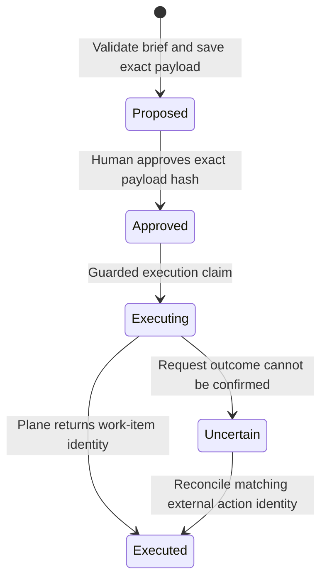

# 4. Agent navigation and approved actions

[Design pack](README.md) · [Previous: data lifecycle](03-data-lifecycle-and-quality.md) · [Next: review and evaluation](05-review-and-evaluation.md)

## Agent operating model

Wayfinder exposes a local MCP server over standard input/output. An external agent client supplies the planning and language-generation loop. The agent can discover the graph schema, resolve entities, traverse connections, inspect discussions, retrieve original evidence, and formulate a structured brief.

Each MCP process queries its configured named graph. Confirm that graph with graph_stats at the beginning of an investigation: Northstar questions belong to `wayfinder_company_demo`, while Kubernetes questions belong to `wayfinder_test_30d`. Changing the client configuration requires restarting its MCP connection. Graph selection is not an MCP tool operation, and the company dashboard is not an agent chat interface. [Graph access and demo boundaries](06-graph-access-and-demo-boundaries.md) describes the separate query surfaces.

The default server has twenty-two database-read-only tools, two resources, and three prompts. Optional action mode adds two tools, for a total of twenty-four. Read tools do not ingest sources, refresh scores, call generation models, or create external work items. Explicit semantic_search makes one configured query-embedding request without retries; page loading and other read tools make no provider requests.

## Tool surface

| Purpose | Tools | Intended use |
|---|---|---|
| Establish scope | graph_stats, graph_schema, knowledge_coverage | Confirm graph, relationship meanings, source coverage, and limitations |
| Find and inspect entities | search_entities, get_entity, semantic_search | Resolve names to stable IDs; read properties and segmented long text |
| Explore connections | get_neighbors, find_paths | Navigate allowed relationship types and directions; inspect bounded connections |
| Recover evidence | get_evidence, get_thread | Resolve cited nodes/relationship IDs; inspect chronological source discussion |
| Engineering knowledge | who_knows, ownership, decisions, concerns, stale_findings | Retrieve versioned activity rankings, declared code ownership, semantic claims, and computed findings |
| Contextual discovery | person_context, component_context, company_context | Explore a person, code directory, or company component using explicit graph links |
| Open work and change | list_questions, recent_activity | Inspect extracted questions and bounded imported activity |
| Flexible query | read_cypher | Answer questions outside fixed tools through database-enforced read-only execution |
| Brief validation | validate_review_brief | Check structured evidence references before review or proposal preparation |
| Optional action mode | prepare_plane_work_item, execute_plane_work_item | Create a local proposal and execute an already approved sandbox task |

who_knows also accepts stable Component IDs, follows current IMPLEMENTED_IN mappings, and deduplicates contribution records across overlapping code roots. The two similarly named component tools serve different contexts. component_context addresses repository directories; company_context addresses declared company Components. Neither is a source of invented dependencies.

## Independent graph navigation

1. Confirm the named graph and read its schema and coverage.
2. Resolve the requested component by search and select an unambiguous stable ID.
3. Inspect ownership and explicitly linked project/work/document context.
4. Follow relevant relationship types, including incoming links when needed.
5. Read the work-item or conversation thread around a claim, not only a summary.
6. Resolve evidence IDs and retrieve the relevant immutable source revision.
7. Compare current claims, their authority, chronology, and concern status.
8. Produce a cited brief, preserving unknowns and coverage limitations.
9. Validate its evidence structure before presenting or preparing an action.

Paths establish graph connectivity. A path through a shared component does not prove that a rationale caused a decision, an author reviewed another person's work, or a comment resolved a concern. The agent must interpret each relationship according to its documented meaning.

The review-component prompt encourages this workflow. It is guidance to an external agent, not a guarantee that all clients will execute every step or cite every statement correctly.

## Worked example: Resource Allocation

This example describes the committed fictional fixture, not a live Plane investigation.

It is the seeded scenario, not a guarantee of the current ADR text. The recorded local live proof subsequently replaces bounded automatic retry with operator-initiated retry. An actual investigation must inspect the current source revision and Decision rather than repeat the seeded statement below. The proof's original baseline, edited pending state, and extracted replacement are separate states; none should be silently substituted for another.

| Investigation step | Available evidence | Defensible conclusion |
|---|---|---|
| Resolve component | Stable ID `company:northstar:component:resource-allocation` | A named company Component exists in the demo graph |
| Inspect owners | Current OWNS_COMPONENT links from Dee Park and Eli Moss | The manifest declares Dee and Eli as owners; this does not grant code review authority |
| Follow project | Component-linked work items connect back to the Allocation project through HAS_WORK_ITEM | The project is reachable through imported work; no direct project-to-component edge is required |
| Inspect six work items | w7–w12: Bound resize retry; Measure reservation drift; Document allocation rollback; Verify resource isolation; Audit capacity owner routing; Track allocation rollout | There is a small, connected work set, not a complete operational backlog |
| Read documents | Reservation-fairness ADR, retry-alternatives RFC, allocation rollback runbook | The graph includes decision, option discussion, and operational guidance |
| Follow code and activity | IMPLEMENTED_IN maps the component to allocation code; who_knows aggregates deduplicated contribution records | Faye is the fixture's leading non-owner file-review contributor; Dee and Eli remain declared owners, and neither designation implies the other |
| Read ADR evidence | “Decision: preserve existing reservations before retrying resize.” | The source text records that decision; its semantic annotation is hand-authored fixture data |
| Read alternatives | Immediate retry considered; unlimited retry rejected because it can starve reservations | Consideration and rejection are distinct; these are related alternatives unless explicit rationale links establish more |
| Inspect concern | “I am concerned that resize retry can starve existing reservations.” | An imported concern targets allocation behavior |
| Check status/evidence | Open status; no qualifying closure evidence | It remains open in the imported graph; this is not a claim about every conversation elsewhere |

Ownership statements repeated in Slack and a page provide inspectable consistency within the fixture. They are not independent real-world corroboration: all records are fictional and deliberately authored for the same scenario.

A suitable brief would identify the owners, cite the decision and alternatives, state the open starvation concern, point to the rollback guidance, and propose a focused follow-up. It would not invent a measured starvation rate, successful test outcome, rollout approval, deadline, or reviewer authorization.

## Brief information contract

| Section | Required content |
|---|---|
| Component | Stable Component or Directory identifier |
| Ownership | Declared responsibilities and cited evidence |
| Contributors | Supported activity observations; empty/unknown when evidence is insufficient |
| Decisions | Recorded outcomes with source quote, revision, and authority |
| Concerns | Current recorded status; specific source evidence for a resolved assertion |
| Missing evidence | Unavailable sources, incomplete coverage, unvalidated claims, and absent authorization |
| Next action | A narrow proposal justified by the investigation |
| Context | Coverage warnings and freshness information |

Each cited claim carries evidence IDs, matching source URLs, and an authority category. Extracted claims also require an evidence quote and current source revision. Concern status is a computed property even when the underlying concern text is extracted.

The validator checks required sections, current evidence existence, URL association, prohibited promotion of interpretation to CONFIRMED, quote/revision consistency, and current concern status. A resolved claim must include its specific resolution source evidence.

Validation remains mechanical. It does not prove entailment, completeness, relevance of every citation, identity beyond stored mappings, reviewer eligibility, or correctness of a recommendation. It is possible to attach real evidence to a misleading summary; human or independent semantic review remains necessary.

## Answer presentation rules

- Attribute declarations to their source and separate them from behavior-based signals.
- Use “contributors” or “activity evidence” for rankings unless reviewer authority is separately established.
- Report score version, supporting PR count, matched scope, and snapshot age when discussing expertise.
- Describe a slash-command test invocation as a request unless execution-result evidence is imported.
- Use exact source kind: an issue conversation comment is not a file-anchored review comment.
- State “open in imported evidence” when closure coverage is incomplete.
- Keep considered alternatives, rejected alternatives, goals, and decisions distinct.
- Cite full stable evidence IDs and source URLs; inspect retained revision text when fixture URLs are simulated.

These are design requirements for reliable answers, not a claim that every free-form agent answer is automatically enforced.

## Read boundaries and resource limits

| Boundary | Current design |
|---|---|
| Database mutation through read tools | Queries use database-enforced read-only execution |
| Query execution | Five-second database timeout for the bounded query service |
| Lists | Default twenty, maximum one hundred where supported; follow continuation cursors |
| Path exploration | At most five hops and ten returned paths |
| Response size | Approximately 64 KiB maximum; large responses are bounded or rejected |
| Long text | Segmented retrieval rather than dumping entire source bodies |
| Embeddings | Hidden from normal entity serialization |
| Custom queries | Caller must constrain result size and apply current/history predicates |

Read-only does not mean inexpensive or privacy-preserving. A custom query can still scan broadly, and result limits applied after database execution do not bound all database work. The timeout and response limits reduce exposure but are not a complete resource-governance system.

## Optional approved Plane action

The only external action in this design is creating a work item in the configured fictional Plane sandbox. Preparation first validates the brief and stores the exact workspace, project, title, description, and evidence brief as a local Action payload. A deterministic payload hash identifies that proposal.

A human reviews that payload and approves its exact hash through the trusted local interface. There is no approval-granting MCP tool. The agent may request execution only after approval exists. Execution checks the hash, current sandbox destination, and current brief validity before attempting one external creation.

Repeated successful execution returns the existing external ID. A timeout does not trigger blind creation again: later execution reconciles by the external action identity. If no match is found, the operation requires investigation rather than an automatic repeat POST. This reduces duplicate creation but is not an exactly-once distributed transaction with Plane.

Payload mutation or evidence that no longer passes validation requires a new reviewed proposal. Revalidation checks the evidence contract, not all possible changes in business context. For example, changed surrounding information that is not represented in the brief may still require human reassessment.

The approval boundary trusts local shell access, manifest control, database access, and the recorded approver name. It is not authenticated enterprise approval, a separation-of-duties guarantee, or protection against an actor with unrestricted local execution permissions.

## Failure behavior

| Condition | Expected handling |
|---|---|
| Wrong graph or ambiguous component | Resolve scope before answering; do not silently combine datasets |
| Missing or retired citation | Reject brief validation; retrieve current evidence |
| Truncated traversal or thread | Follow pagination and narrow the investigation |
| Missing review authorization | Report it as unknown; do not turn ownership or activity into permission |
| Outdated expertise | Warn and request an explicit refresh through the operational workflow |
| Expensive custom query | Timeout or narrow query; do not assume output truncation makes it cheap |
| Evidence change after proposal | Revalidate; create and approve a new proposal if validation fails |
| Uncertain task-creation result | Reconcile with Plane using action identity; do not blindly retry creation |
