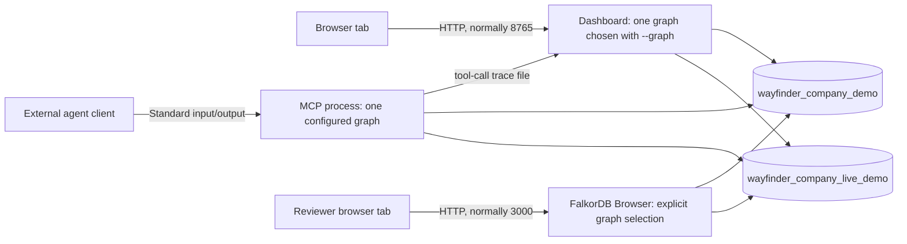

# 6. Graph selection, connections, and query access

[Design pack](README.md) | [Previous: review and evaluation](05-review-and-evaluation.md)

## Purpose and current dataset boundaries

This document explains how reviewers and agents reach the saved knowledge. It describes the current design and its limits without requiring implementation code. Operational commands and client configuration belong in the [setup guide](../../README.md) and [MCP guide](../MCP.md).

| Named graph | Evidence stored | Review purpose | Boundary |
|---|---|---|---|
| `wayfinder_company_live_demo` | Actual API records about building Wayfinder: Plane tasks, pages and comments; staged bot discussions in two Slack channels; this repository's PRs, reviews, branches and commits; owner-approved extracted claims; an executed approved action | Real connector retrieval, freshness, cross-source links, agent navigation and the approved action | Plane/Slack content is a staged scenario; no fixture annotations; expertise reflects one main author |
| `wayfinder_company_demo` | Fictional Northstar identities, teams, components, Plane-shaped work and pages, Slack-shaped discussions, and eight synthetic GitHub PRs with OWNERS | Owner-versus-expert code expertise and the recorded source-edit proof | Synthetic records and fixture annotations; not organizational truth |
| `wayfinder_company_live_replay` (optional) | The live graph's current Plane/Slack records, rebuilt from a scrubbed recording | Rebuilding without credentials | Coverage is labelled `replay`; no GitHub records and no extraction |

The graphs live in the same local FalkorDB instance. They share application services and vocabulary but have separate records and coverage. There is no federation or automatic cross-graph answer, and named graphs are not tenant authorization.

The live graph's seeded story has 12 assigned Plane tasks, 20 comments, 6 pages and 30 discussion messages in six threads, plus one disclosure per channel. Later records were added:

- FALKORDBTE-15 and a Slack thread, from the sync test.
- FALKORDBTE-16, from the approved action.
- GitHub activity, kept current by sync.

Current Components are Source Ingestion & Evidence and Agent Review Workflow. Source dates are actual timestamps. Ingestion success is not extraction success: 10 claims exist from bounded runs, and several pages remain unextracted. The [project story](../WAYFINDER-PROJECT-DEMO.md) and [live workspace walkthrough](../LIVE-WORKSPACE.md) describe these states.

## Connection model

The two arrows from each process show alternative configurations, not simultaneous access.

**Dashboard.** It serves the graph named by `--graph`:
- The evidence views at `/` are built for Northstar. On another graph, their state endpoint returns a message pointing to `/graph`.
- `/graph` draws the selected graph and polls the local tool-call trace written by MCP processes on the same graph, so an agent's path appears within about a second.

**MCP.** Each process records the tool, its arguments, and the entities and relationships found in its arguments and results. This recording never changes a result, and `--no-trace` turns it off.

Page loading and the graph view make no ingestion, model, embedding or Plane requests. Explicit semantic search requests one query embedding, and live-proof controls permit capped model requests only when live mode is enabled. Recorded proof and capability logs describe past runs.

## Selection contract

| Surface | Selection rule | Important limit |
|---|---|---|
| Dashboard | `--graph` chooses the graph (Northstar by default) | The evidence views target Northstar; use `/graph` for the live graph |
| MCP client | The process reads `FALKORDB_GRAPH` from its client configuration | The repository `.env` may name another graph; set it explicitly and restart the client after changes |
| Agent-path view | Follows MCP sessions recorded for the dashboard's graph | A client on a different graph writes a different trace and does not appear |
| FalkorDB Browser | The reviewer selects the named graph before running Cypher | A Northstar query run on the live graph won't resolve Northstar entities |
| Command line | `--graph` and `--manifest` on each command | Commands do not follow the dashboard's selection |

An investigation begins by verifying graph identity with `graph_stats`, then source coverage and snapshot freshness. A graph with no matching entity is not proof that the real component has no owners or activity.

## Supported query paths

The dashboard offers its evidence views, the graph view with session replay, evidence inspection, semantic discovery in enabled live mode, and copyable example queries. It is not a chat surface or a general Cypher console.

An MCP-connected agent navigates independently with schema discovery, entity search, current neighbours, bounded paths, threads and evidence retrieval. It calls `who_knows` with a Component ID or directory, `read_cypher` through the database-enforced read-only surface, and `semantic_search` through native vector indexes. In action mode, it can prepare and execute an approved Plane task; approval stays outside MCP.

FalkorDB Browser provides direct Cypher, without Wayfinder's read-only guard, response bounds or brief validation. The [query catalog](../QUERIES.md) explains the product's dependent queries.

| Review question | Graph and route | Evidence required |
|---|---|---|
| What connects a task, its discussion and its code? | Live graph: `search_entities`, `get_neighbors`, `get_thread`, `get_evidence` | URL or key references, PR head/base branches and commits, source URLs |
| Why must agent-created tasks be approved? | Live graph: current Decision, source revision | Exact ADR-002 quote, authority and origin |
| Who owns Resource Allocation, and who has code-review evidence? | Northstar: `company_context`, IMPLEMENTED_IN, `who_knows` | Declared ownership separately from computed contributions and supporting PR counts |
| How is a component connected to a contributor? | Either graph: bounded `find_paths` or a Browser query | Edge meanings; a path proves connectivity, not competence or causality |

## Failure interpretation

| Symptom | What it establishes | What it does not establish |
|---|---|---|
| Dashboard page opens but state loading fails | The HTTP service is reachable while a backend dependency fails, or the evidence views were opened on a non-Northstar graph | That the graph is empty or credentials are invalid |
| Connection refused on the database port | No database connection at that address during the attempt | That a named graph was deleted |
| Graph view shows "Waiting for MCP tool calls" | No traced session yet on this graph | That the agent is disconnected; check its `FALKORDB_GRAPH` and that tracing is on |
| Sync reports a source as `unavailable` | That source failed for this run; other sources still synced | That records were deleted |
| Successful query with no matching rows | No match under that query, graph and validity filters | Complete absence of real-world evidence |

## Review acceptance checks

1. Establish database availability independently of the dashboard.
2. Verify graph identity on every newly configured MCP connection and in FalkorDB Browser.
3. Run `scripts/verify_live_workspace.py` before a live demonstration.
4. Demonstrate the live graph's task → discussion → PR → commit links with the agent-path view, and Northstar owners versus contributors.
5. Treat saved proof logs as historical unless their source revision matches the current graph. Re-importing the Northstar fixture resets its ADR overlay.
6. Keep direct Browser access distinct from the guarded MCP read surface and the approved Plane action path.
