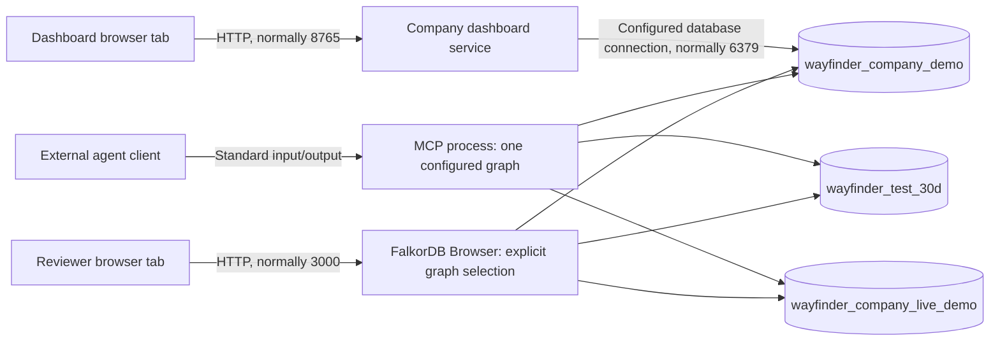

# 6. Graph selection, connections, and query access

[Design pack](README.md) | [Previous: review and evaluation](05-review-and-evaluation.md)

## Purpose and current dataset boundaries

This document explains how reviewers and agents reach the saved knowledge. It describes the current design and its limits without requiring implementation code. Operational commands and client configuration examples belong in the [setup guide](../../README.md) and [MCP guide](../MCP.md).

| Named graph | Evidence stored | Review purpose | Preservation boundary |
|---|---|---|---|
| `wayfinder_test_30d` | Imported Kubernetes people, repository paths, OWNERS, PRs, reviews, comments, KEPs, documentation, and derived expertise | Public engineering investigation and source-specific ownership/expertise analysis | Retained separately when Northstar was added; not replaced by the fixture |
| `wayfinder_company_demo` | Fictional Northstar identities, teams, components, Plane-shaped work/pages, Slack-shaped discussions, and eight synthetic GitHub PRs with OWNERS | One connected Company Brain investigation, including code expertise | Contains synthetic company code evidence, not a copy of Kubernetes repository activity |
| `wayfinder_company_live_demo` | Actual API records about building Wayfinder: tasks, documents, comments, and staged bot discussions | Verify real connector retrieval, ownership, dependencies, IDs, coverage, and source links | Separate graph; no fixture semantic annotations, GitHub PRs, or fabricated human Slack authorship |

The suffix `30d` is a graph name, not a retention policy or query filter. An import date window, event timestamps, retained history, and the expertise calculation clock are separate facts. Claims about the last thirty days must be established from those facts rather than the graph name.

All three graphs reside in the same local FalkorDB instance in the reviewed deployment. They share application services and vocabulary but have separate records and coverage. Expertise state exists where code activity has been calculated; the live connector graph has no code evidence. There is no application federation or automatic cross-graph answer. Named graphs also do not provide tenant authorization.

The live connector setup has 12 assigned Plane tasks, 20 comments, 6 pages, and 30 discussion messages in six threads, plus one disclosure per channel. The current story describes the Wayfinder project: four verified completed tasks, three in progress, five Todo, 23 task dependencies, and 22 current labeled Slack-to-Plane references. All are read back through the actual APIs with native IDs and real authorship preserved. Current Components are Source Ingestion & Evidence and Agent Review Workflow; the former infrastructure Components are retired with history retained. Source dates use actual timestamps rather than a fixture anchor. Semantic extraction is pending explicit approval to send selected text to OpenRouter; ingestion success is not extraction success. The [project story](../WAYFINDER-PROJECT-DEMO.md) and [live workspace walkthrough](../LIVE-WORKSPACE.md) distinguish these states. The dashboard continues to show the original company demo graph.

Kubernetes ranking preservation was verified at a fixed clock and generation; the [recorded comparison](../evidence/kubernetes-ranking-compatibility.json) reports unchanged output for the captured requests. This does not mean scores are permanently frozen. A later explicit refresh can change rankings as evidence and decay change.

## Connection model

The three arrows from the MCP process show alternative configurations, not simultaneous access or a federated query. The database graph symbols belong to one FalkorDB instance. The dashboard and FalkorDB Browser are separate interfaces.

The dashboard's initial Connecting label refers to fetching application state from its HTTP backend. The backend reads company context, expertise, index metadata, and recorded evidence artifacts. Successful loading replaces the label with the selected graph name. It is not a Plane, Slack, GitHub, agent, or model-provider login indicator, and the application does not maintain a continuous graph subscription through that label.

Page loading does not ingest sources, generate interpretations, request embeddings, create tasks, or refresh expertise. Explicit semantic search requests one query embedding. Explicit live-proof controls permit capped model requests and local ADR edits only when live mode is enabled. Recorded proof and capability logs describe past runs, not fresh provider requests made whenever a page opens.

## Selection contract

| Surface | Selection rule | Important limit |
|---|---|---|
| Dashboard | The normal entry point explicitly targets `wayfinder_company_demo` | Selecting Resource Allocation or Node Runtime changes the company Component, not the named graph; there is no Kubernetes dashboard view |
| MCP client | The process reads its graph configuration, including `FALKORDB_GRAPH` | Restart the client connection after changing the configuration; changing the dashboard does not change an already-running MCP process |
| FalkorDB Browser | Reviewer selects the named graph before executing Cypher | Copying a company query into the Kubernetes graph will not resolve Northstar entities |
| Local command-line operations | Use their documented graph selection rules | Do not assume every command follows the dashboard's explicit company default |

An investigation begins by verifying graph identity, then source coverage and snapshot freshness. Northstar Component IDs and Kubernetes directory paths are different entry points. A graph with no matching entity is not proof that the corresponding real component has no owners or activity.

## Supported query paths

The dashboard supports its three fixed views, evidence inspection, semantic discovery in enabled live mode, and copyable example queries. It is not a natural-language chat surface or a general Cypher console.

An MCP-connected agent can independently navigate using schema discovery, entity search, current neighbors, bounded paths, threads, and evidence retrieval. It can ask who_knows for a Northstar Component or a Kubernetes directory in the appropriate graph. Custom read_cypher queries use the database-enforced read-only surface and its execution/output limits. Explicit semantic_search uses native vector indexes after obtaining a query embedding; lexical and structural navigation remain available without that provider request.

FalkorDB Browser provides direct graph inspection and Cypher execution. It does not inherit Wayfinder MCP's read-only guard, response envelope, or brief validation. The reviewer is responsible for selecting the correct graph, constraining queries, and preserving current/history predicates. The [query catalog](../QUERIES.md) explains the product's dependent queries and their semantics; the dashboard provides a smaller copyable subset.

| Review question | Appropriate graph and route | Evidence required |
|---|---|---|
| Who owns Resource Allocation, and who has code-review evidence? | Company graph: company_context, IMPLEMENTED_IN, who_knows, evidence retrieval | Declared ownership separately from computed peer-review/implementation contributions and supporting PR counts |
| Why did retry policy change, and what concern remains? | Company graph: current Decision, source revision, concern and closure evidence | Current ADR text, authority/origin, validity, and specific resolution evidence if closure is claimed |
| Who knows pkg/kubelet, and are they authorized reviewers? | Kubernetes graph: who_knows, ownership, file-review evidence | Published score generation, event/PR scope, command exclusions, and independent OWNERS authorization |
| How is a component connected to a contributor? | Company graph: bounded find_paths or Browser query | Actual edge meanings; a path proves connectivity, not competence or causality |

## Failure interpretation and known reporting gap

The October 17 connection investigation observed the existing local FalkorDB container stopped. This was a runtime observation, not a change to the graph design or evidence that the data had been removed. The documented deployment mounts persistent data outside the container; deleting that storage is a different operation from stopping a container. Backup and restore readiness require their own checks.

| Symptom | What it establishes | What it does not establish |
|---|---|---|
| Dashboard page opens but state loading fails | Static assets or the HTTP service may be reachable while a backend dependency fails | That the company graph is empty or source credentials are invalid |
| Connection refused on the database port | No database connection could be established at the selected address during that attempt | That either named graph was deleted |
| Initial Connecting label remains visible | Initial data loading did not reach its normal success update | A continuous provider login or a reliable database health signal |
| Unexpected token / invalid JSON error | The client attempted to parse a non-JSON response, such as a plain-text server error | The underlying cause; inspect the HTTP status and server error |
| Successful query with no matching rows | No match under that query, selected graph, and validity filters | Complete absence of real-world evidence |

The current UI error reporting does not reliably distinguish these cases. Clear disconnected/degraded states and structured backend errors remain an explicit usability gap; this documentation update does not claim that behavior has been fixed.

## Review acceptance checks

1. Establish database availability independently of the dashboard's initial label.
2. Verify graph identity on every newly configured MCP connection and in FalkorDB Browser.
3. Demonstrate Northstar owners, code contributors, decisions, concerns, and sources in one company investigation.
4. Switch explicitly to Kubernetes for the engineering appendix; state that its evidence and coverage are separate.
5. Treat saved proof logs as historical unless their source revision matches the current graph. Reimporting the fixture can reset the ADR and retire a previous live-proof replacement.
6. Keep direct Browser query access distinct from the guarded MCP read surface and approved Plane action path.
